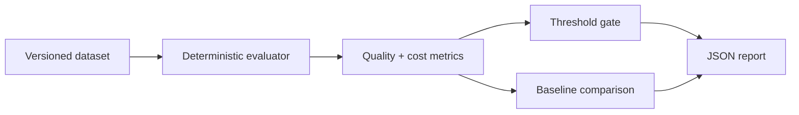

# rag-eval-harness

Regression tests for retrieval systems, without a model judging the model.

The harness reads versioned JSON datasets and produces deterministic retrieval, ranking, grounding, citation, latency, and cost metrics. It has no provider SDKs and makes no network calls.

```sh
npm ci
npm test
npm run example
```

Use thresholds in CI:

```sh
node dist/cli.js examples/support-v1.json \
  --min recallAtK=0.8 \
  --min groundedness=0.9 \
  --max latencyMs=500 \
  --max costUsd=0.02 \
  --out result.json
```

Exit code `0` means the gate passed, `2` means metrics missed a threshold, and `1` means the input or command was invalid.

## Metrics

- precision@k and recall@k
- mean reciprocal rank and nDCG@k
- required-fact groundedness
- citation precision
- normalized exact match
- average and total latency and cost
- baseline-to-candidate regression deltas with per-metric tolerances



Datasets should contain synthetic, licensed, or consented material. Raw prompts and answers are treated as sensitive: trace attribute helpers redact content-like fields by default. The library does not upload datasets or reports.
